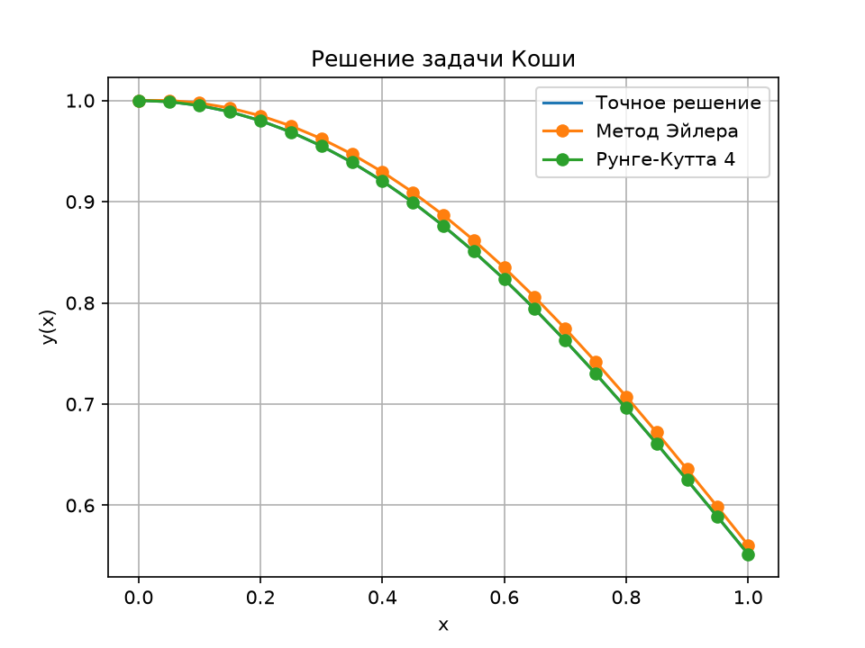

# Лабораторная работа № 2

Численное решение дифференциального уравнения методами Эйлера и Рунге-Кутты 4-го порядка.

## Условие

Решить задачу

```text
y' + 2*x*y = x*exp(-x^2)
y(0) = 1
0 <= x <= 1
h = 0.05
```

## Точное решение

Переносим `2*x*y` вправо:

```text
y' = x*exp(-x^2) - 2*x*y
```

Это линейное уравнение. После умножения на `exp(x^2)` левая часть становится производной произведения:

```text
(y*exp(x^2))' = x
```

Интегрируем и подставляем `y(0) = 1`:

```text
y(x) = (1 + x^2/2)*exp(-x^2)
y(1) = 0.551819161757...
```

## Как работает программа

1. Делит отрезок `[0, 1]` на 20 шагов по `0.05`.
2. Функция `f(x, y)` вычисляет правую часть уравнения. В Python `math.exp(-x*x)` означает `e^(-x^2)`.
3. Списки `euler_values` и `rk4_values` хранят найденные значения `y`.
4. На каждом шаге считает новое значение методом Эйлера.
5. На том же шаге считает новое значение методом Рунге-Кутты. `k1`, `k2`, `k3`, `k4` — четыре оценки приращения за шаг.
   Итоговая формула: `новое y = y + (k1 + 2*k2 + 2*k3 + k4) / 6`.
6. Сравнивает оба приближения с точной формулой.
7. Сохраняет полную таблицу в `results.csv` и график в `solutions.png`.

Сами вычисления записаны простыми функциями, списками и циклами `for`. Формулы методов находятся прямо рядом с кодом, который их считает.

## Результаты

| Метод | Приближённое значение при `x = 1` | Абсолютная ошибка |
| --- | ---: | ---: |
| Эйлер | 0.560752036129 | 0.008932874372108 |
| Рунге-Кутта 4 | 0.551819160911 | 0.000000000846557 |

Полная таблица значений: [results.csv](results.csv).



## Как запустить

Нужен Python и библиотека `matplotlib`. В терминале, открытом в папке проекта, выполни:

```text
python -m pip install -r requirements.txt
python main.py
```

После запуска программа напечатает таблицу и ошибки, а также обновит файлы `results.csv` и `solutions.png`.
